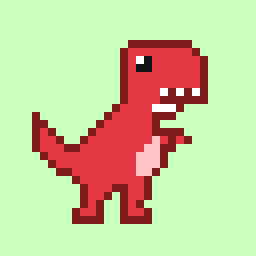
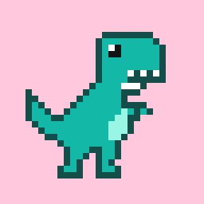

  

<h1 align="center">play-rex</h1>

  Before the screens, there was a table: a worn-out deck, a scorepad full of crossed-out numbers, and always someone who wanted one more round. Somewhere along the way we learned the game was never really about winning; it was about who sat with you. We're a bunch of Magdeburgers who never quite left that table, so we're building our own games to keep the seats warm.

  Vor den Bildschirmen gab es einen Tisch: ein abgegriffenes Kartenspiel, ein Block voller durchgestrichener Punkte und immer jemand, der noch eine Runde wollte. Irgendwann haben wir gemerkt, dass es nie wirklich ums Gewinnen ging, sondern darum, wer mit am Tisch saß. Wir sind ein Haufen Magdeburger, die diesen Tisch nie ganz verlassen haben, also entwickeln wir unsere eigenen Spiele, damit die Plätze warm bleiben.

<h2 align="center">Team</h2>

<table align="center">
  <tr>
    <td align="center" width="140"> <b>Ahamad</b> Engineer · Entwickler</td>
    <td align="center" width="140"> <b>Aravind</b> Engineer · Entwickler</td>
    <td align="center" width="140"> <b>Harsha</b> Engineer · Entwickler</td>
    <td align="center" width="140"> <b>Pradeep</b> Lead · Leitung</td>
    <td align="center" width="140"> <b>Vedamsh</b> Engineer · Entwickler</td>
  </tr>
</table>
