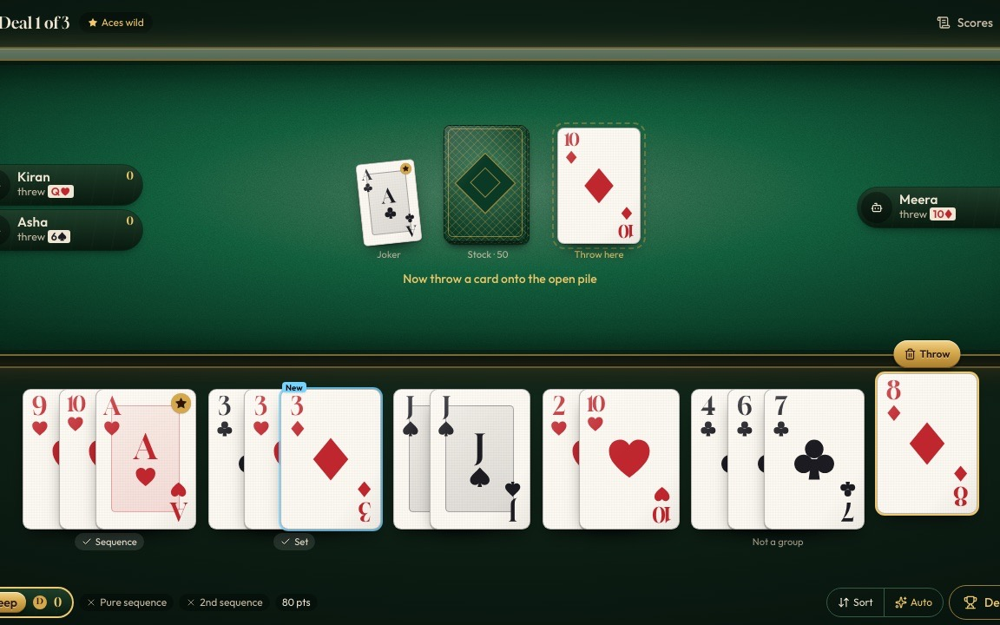
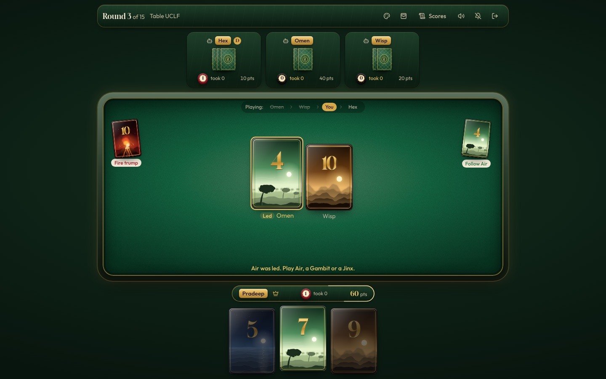
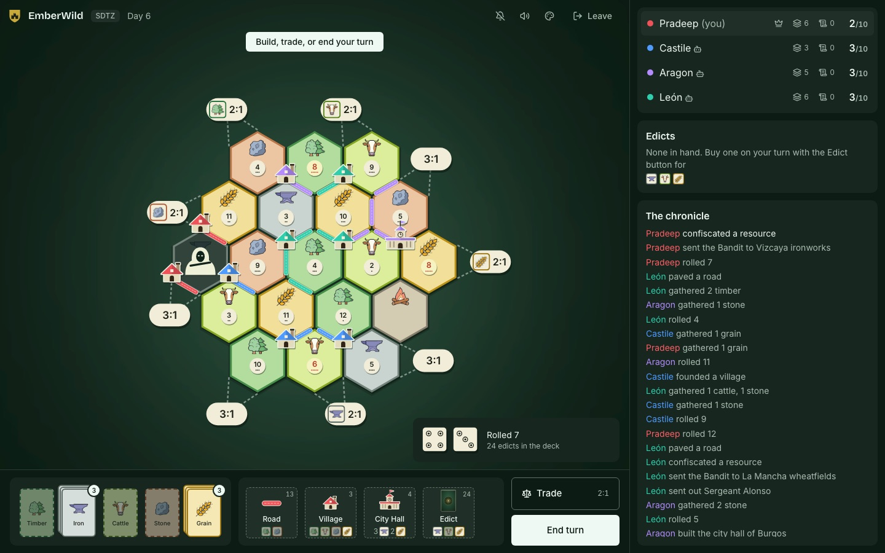

  

<h1 align="center">play-rex</h1>

  Free card and board games for the browser. Play with friends from a shared link, or fill empty seats with bots. 
  No sign-up and nothing to install. Works on phones too.

  <a href="https://play.rxnova.dev"><b>▶ play.rxnova.dev</b></a>

<table>
  <tr>
    <td width="33%" valign="top">
      
      <h3><a href="https://rummy.rxnova.dev">Rummy</a></h3>
      13-card rummy for 2–6 players. Arrange your hand into sequences and sets, then show before anyone else.
    </td>
    <td width="33%" valign="top">
      
      <h3><a href="https://jinx.rxnova.dev">Jinx Gambit</a></h3>
      Trick-taking for 3–6 players. Call exactly how many tricks you'll take. You only score if you hit it.
    </td>
    <td width="33%" valign="top">
      
      <h3><a href="https://wild.rxnova.dev">EmberWild</a></h3>
      Trading and building for 2–6 players. Found villages, bargain with rival houses and race to the renown target.
    </td>
  </tr>
</table>
